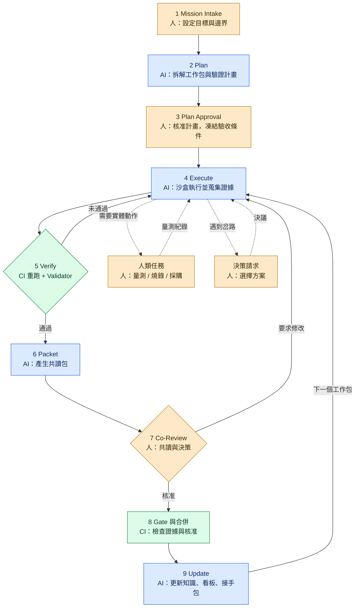

# 09 — 執行流程 Playbook：AI 開發 × 人類共讀 × 共推進度

**文件狀態：** 設計提案 v0.3 · 2026-11-13
**適用：** 軟體、韌體、硬體與跨領域（系統整合）研發工作。
**注意：** 本文描述的 `aitw` 工具與自動化**尚未實作**（規格見 [11](11-toolkit-spec.md)，開發工單見 [13](13-opus-handoff.md)）。第 12 節說明工具完成前如何以手動模式運作。文內時間與上限均為**試行假設**。

## 0. 這份文件補上什麼

01–08 定義了原則與目標平台，但有四個缺口：

| 缺口 | 現況 | v0.3 的作法 |
|---|---|---|
| 沒有可照做的 SOP | 02 是狀態機與原則層級 | 本文：每一步「誰、做什麼、用什麼、產出什麼、何時算完成」 |
| 韌體／硬體沒有具體邊界 | 01 §7 僅列注意事項 | [10](10-domain-profiles-sw-fw-hw.md)：各領域自主度、驗證階梯、證據、Gate |
| 「共推進度」沒有機制 | 只有共讀（review） | 本文 §7：決策佇列、人類任務接力、WIP 上限、方向指示 |
| 要等後端平台才能用 | T01–T12 平台優先 | **Git-native Operating Kit**：先用版控檔案 + PR + CI + CLI 跑起來 |

**核心轉向：流程先在 Git 上能運作，Mission Control 平台之後只是讀同一份資料的檢視層。**

**平台用語：** 本文以「PR」泛稱共讀面；在 GitLab 上即 Merge Request（MR）。單位既有案例採 GitLab，其對照、強制方式與漸進導入階梯見 [14](14-gitlab-profile.md)。

## 1. 五條運作規則（補充 01 的設計原則）

1. **檔案是狀態、PR 是共讀面、CI 是關卡。** 任務、證據、決策都是版控檔案；人類在 forge（GitHub 等）上的已驗證身份行為（PR review、留言）是核准的**正本**。
2. **人類注意力是瓶頸。** AI 產出速度遠高於人類審查速度，所以用審查分級、WIP 上限與決策時限保護人類時間。
3. **AI 不能自己把東西標成 VERIFIED。** 只有「CI 在乾淨環境重跑通過」或「人類依原始資料簽認」可以升級為 VERIFIED。
4. **實體世界的動作由人執行。** 燒錄實機、上電、量測、送板、採購：AI 準備程序與分析資料，人動手並簽名。
5. **進度 = 已被接受的工作包。** 不採用 AI 自估百分比。

## 2. 物件模型（全部是版控檔案）

| 物件 | 中文 | 是什麼 | 誰建立 | 檔案位置（專案 repo 內） |
|---|---|---|---|---|
| Mission | 任務目標 | 人類設定的目標、邊界、成功定義、預算 | Primary（AI 協助起草） | `work/missions/M-001-<slug>/mission.md` |
| Work Package (WP) | 工作包 | AI 或人執行的最小可驗收單位 | AI 拆解，人核准 | `…/wp/WP-003-<slug>/wp.md` |
| Evidence | 證據 | 指令、輸出、雜湊、版本、條件 | AI／CI／人 | `…/WP-003-…/evidence/manifest.yaml` |
| Claim | 主張 | 一句可被檢驗的結論 + 標籤 + 證據連結 | AI | 寫在共讀包內 |
| Review Packet | 共讀包 | 給人類讀的一頁式審查文件（固定版本） | AI 產生 | `…/WP-003-…/review/packet-r1.md` |
| Decision Request (DR) | 決策請求 | AI 需要人類決定的選項題 | AI | `…/WP-003-…/decisions/DR-001.md` |
| Steering Note | 方向指示 | 人類給 AI 的約束或方向修正 | 人 | `work/missions/M-001-…/steering.md` |
| Digest | 週摘要 | 給 Backup 的 3–5 條重大變化 | AI | `cadence/digests/2026-W46.md` |
| Sync Record | 共推會議紀錄 | 每週共讀共推會的議程與結論 | AI 起草，人確認 | `cadence/sync/2026-11-16.md` |
| Takeover Package | 接手包 | 02 §6 定義的接手快照 | AI | `takeover/TKO-2026-11/` |

標籤沿用 02 §3：VERIFIED / OBSERVED / HYPOTHESIS / RECOMMENDATION / UNKNOWN / REJECTED。

## 3. 自主度、Gate 與審查深度

每個 WP 在規劃時就決定三件事：**AI 可以做到哪**（自主度）、**過哪一關**（Gate，沿用 05 §4）、**人要讀多深**（審查層級）。

| 自主度 | 意義 | 對應 Gate | 典型例子 |
|---|---|---|---|
| A3 | AI 自主完成，人類批次略讀 + 抽查 | G0 | 文獻整理、誤差預算分析、離線資料分析、文件 |
| A2 | AI 完成，人類審查後才合併 | G1 / G2 | 程式、韌體（主機端可測部分）、計算、模擬、電路圖建議 |
| A1 | AI 準備，**人執行**，AI 分析結果 | G3 | 實板燒錄、上電、量測、送板製造、採購、正式部署 |
| A0 | 人主導，AI 只當顧問與紀錄 | G2 / G3 | 安全簽核、PCB 佈線定案、對外發布 |

| 審查層級 | 人類要做什麼 | 時間假設 | 預設適用 |
|---|---|---|---|
| R0 | 不逐件看；每週抽查 10–20% | — | （P2 才開放，需先有錯誤率基準） |
| R1 | 略讀共讀包，一次批准當日批次 | ≤5 分鐘／批 | G0 |
| R2 | 讀共讀包 + 「必看清單」中的檔案／行／圖 | 15–30 分鐘 | G1、G2 |
| R3 | 正式設計審查會議 + 檢查表逐項簽認 | 30–60 分鐘 | G3、安全相關、硬體釋出 |

**實際 Gate = max（WP 宣告值, 依變更路徑由 policy 推導的值）**，AI 無法調降；policy 檔本身只有人類能改（見 11 §5）。

## 4. 主流程（九步）

圖例：橘色＝人類、藍色＝AI Agent、綠色＝CI 與獨立驗證；虛線＝執行中的支線。

| # | 步驟 | 誰 | 做什麼 | 工具（規劃中） | 產出 | 完成條件 |
|---|---|---|---|---|---|---|
| 1 | Mission Intake | Primary（Backup 共讀） | 回答 AI 的訪談題：目標、成功定義、不做什麼、風險邊界、預算、期限 | `/mission-intake` → `aitw mission new` | `mission.md` | Mission PR 經 Primary 核准合併 |
| 2 | Plan | Orchestrator | 拆成 WP；每個 WP 寫驗收條件、驗證指令、領域、Gate、執行者（ai/human/pair） | `/wp-plan` → `aitw wp new` | 多個 `wp.md`（Plan PR） | `aitw lint` 通過；每個驗收條件都有驗證方式 |
| 3 | Plan Approval | Primary（G2 以上加 Reviewer） | 審計畫：範圍對不對、驗收條件夠不夠嚴、哪些 WP 需要個別啟動核准 | PR review | 合併的 Plan PR | **驗收條件自此凍結**（之後變更需人類核准） |
| 4 | Execute | Engineer / Research Agent | 在 `wp/WP-xxx` 分支與沙盒內工作；每個結果都用 evidence 指令留證 | `/wp-run` → `aitw evidence run` | diff + `manifest.yaml` | 所有驗收條件都有對應證據；草稿 PR 已開 |
| 5 | Verify | CI + Validator Agent | CI 在乾淨環境依**主幹上凍結的**驗證指令重跑；Validator 獨立檢查主張與證據 | `aitw verify`、`/wp-verify` | `verification-r1.md` | CI 綠燈；Validator 給 PASS / FAIL / BLOCKED |
| 6 | Packet | Co-Review Assistant | 產生共讀包：摘要、主張表、必看清單、未驗證範圍、提問、回退方式 | `aitw packet build` | `packet-r1.md` | 送審；若超過審查者 WIP 上限則排隊 |
| 7 | Co-Review | Primary + Backup（+ Reviewer） | 依審查層級共讀、留言、回答挑戰題、做決定 | PR review、`/coread` | 審查紀錄 | APPROVE／REQUEST_CHANGES／REJECT／DEFER |
| 8 | Gate & Merge | CI | 檢查：證據完整且未過期、核准者身份與人數、核准綁定最新版本 | `aitw gate check` | Gate 報告 | 通過才可合併 → ACCEPTED |
| 9 | Update | Handover Agent | 更新研究記憶、看板、追溯矩陣、接手包索引 | `aitw board build` 等 | `STATUS.md`、看板 | 看板數字可由檔案重算 |

**第 4 步的兩條支線：**
- **決策請求**：AI 遇到需要人判斷的岔路（方案取捨、規格解讀）時建立 DR，繼續做不相依的工作，不停下來空等。
- **人類任務**：需要實體動作時，AI 產生程序書與紀錄表，由合格人員執行（§7.3）。

## 5. 狀態與 Git 事實的對照

狀態沿用 02 §2 的狀態機，但**盡量由 Git／forge 事實推導**，不靠人或 AI 手動改欄位（避免「檔案說 RUNNING、實際早已合併」）。

| 狀態 | 由什麼事實決定 |
|---|---|
| PROPOSED | WP 檔只存在於尚未合併的 Plan PR |
| PLANNED | WP 檔已在主幹；尚無 WP 分支 |
| AWAITING_APPROVAL | WP 標示需個別啟動核准，且對應 DR 尚未被授權人類批准 |
| APPROVED | 啟動核准紀錄已合併（或 policy 允許免個別核准，記錄 policy id） |
| RUNNING | `wp/WP-xxx-*` 分支存在，PR 為草稿 |
| VERIFYING | PR 轉為 ready；CI／Validator 進行中 |
| IN_REVIEW | 驗證通過；等待人類審查 |
| REWORK | 有人類 REQUEST_CHANGES，或驗證 FAIL |
| ACCEPTED | PR 經 Gate 通過後合併 |
| BLOCKED | WP 標示阻擋原因 + 下一步動作 + 負責人（可疊加在任何進行中狀態） |
| ARCHIVED | 人類決定終止，保留紀錄 |

## 6. 共讀協定（Co-Read Protocol）

### 6.1 共讀包的固定結構

每次送審產生一份**固定版本**的共讀包（綁定 commit），人類不需要自己從 diff 拼湊全貌：

1. **三行摘要**：改了什麼／為什麼／影響誰。
2. **主張表**：每條結論 + 標籤 + 證據編號 + 適用範圍限制。
3. **必看清單**：指定到檔案行號／圖／表，附預估時間。
4. **可略讀**：機械性變更、產生檔。
5. **未驗證範圍與已知失敗**。
6. **給人類的問題**：需要決定的事（連到 DR）。
7. **挑戰題**：一題檢驗理解的問題（主要給 Backup）。
8. **回退方式**。

### 6.2 「必看清單」的產生規則（由 policy 決定，不由 AI 自由發揮）

以下項目**一律**列入必看，AI 可以加、不可以減：

- 落在 policy 標示的安全關鍵路徑的變更（例：保護門檻、bootloader、電源路徑）。
- 介面契約（ICD：腳位、暫存器、通訊協定、電源軌）的任何變更。
- **測試被刪除、放寬或跳過**的地方（防止「改測試讓它過」）。
- 驗收條件或驗證指令的變更。
- Validator 與 Engineer 結論不一致之處。
- AI 自己標示低信心或 HYPOTHESIS 的結論。
- 人類任務紀錄中的偏離與異常。

### 6.3 閱讀層級的紀錄

| 層級 | 怎麼算 | 用途 |
|---|---|---|
| 已讀 | 在 PR 留 `/read` | 只代表看過 |
| 已理解 | 回答挑戰題（`/understood <答案>`），由 Primary 或 Reviewer 認可 | Backup 維持 L1 的佐證 |
| 可接手 | **只能**由接手演練結果取得（02 §6） | L2／L3 |

### 6.4 留言前綴（讓 AI 與人都能快速分類）

`Q:` 提問 · `RISK:` 風險 · `CHANGE:` 要求修改 · `NIT:` 小建議（不擋合併） · `STEER:` 方向指示（會寫入 steering）。

### 6.5 意見分歧

Primary 對研究方向有最終決定權；Backup／Reviewer 的異議**必須被記錄**（寫入決策紀錄的 `dissent` 欄位），不可因合併而消失。涉及安全的異議可升級到 Manager，升級期間該 WP 維持 BLOCKED。

## 7. 共推協定（Co-Drive Protocol）

「共讀」是一起看懂；「共推」是人類實際參與把進度往前推。人類有四個推進槓桿：

### 7.1 看板四欄（人只需要看這四欄）

| 欄 | 內容 | 人類動作 |
|---|---|---|
| **等我決定** | 待核准的計畫、待審的共讀包、未答的 DR | 審查、決定 |
| **等我動手** | 指派給人的實體任務（量測、燒錄、採購） | 執行並填紀錄 |
| **AI 進行中** | RUNNING／VERIFYING 的 WP | 只在想改方向時介入 |
| **卡住** | BLOCKED 與逾期項目 | 解除阻擋或升級 |

### 7.2 決策佇列與時限

- 每個 DR 必須寫：選項、各選項的影響與可逆性、AI 建議、`needed_by` 日期、「不決定的話哪些 WP 會停」。
- 時限（試行假設）：G1 兩個工作天、G2 三個工作天；逾期提醒 Backup，再逾期升級 Manager。
- **不採用「逾期視為同意」**，唯一例外：Plan 核准時人類已在該 WP 預先授權「可逆的低風險選項可依 AI 建議先行」，且共讀包必須醒目標示。G2 以上一律不適用。
- AI 等待期間改做不相依的 WP；沒有可做的就停，不製造假進度。

### 7.3 人類任務接力（硬體／韌體的關鍵機制）

實體動作以 `executor: human` 的 WP 表示，形成「AI → 人 → AI」接力：

1. **AI 準備**：程序書、接線／設定表、要量的點、預期範圍、中止條件、空白紀錄表。
2. **人類啟動核准（G3）**：合格人員審程序書與安全檢查表後批准。
3. **人執行**：依程序操作，填紀錄表，原始資料存入受控位置並登錄雜湊。偏離程序的地方照實記錄。
4. **AI 分析**：資料標為 OBSERVED，與預期比對，產生共讀包。
5. **人簽認**：Reviewer 依原始資料把結論升為 VERIFIED 或退回。

AI 不連線儀器、不發燒錄或控制命令（由工具層的拒絕清單強制，見 11 §8）。

### 7.4 方向指示（Steering）

人類隨時可用 `STEER:` 留言或直接編輯 `steering.md` 加入約束（例：「不要換 MCU」「優先低溫段」）。Orchestrator 下一次規劃必須逐條回應「已採納／無法採納及原因」，不可默默忽略。

### 7.5 WIP 上限（保護人類）

| 上限 | 預設值（試行） | 觸頂時 AI 的行為 |
|---|---|---|
| 每位審查者同時待審的 WP | 3 | 不再送審；改做 G0 準備工作或停止 |
| 未答 DR 總數 | 5 | 不再開新 DR；合併相關問題 |
| 單一 WP 返工次數 | 3 | 轉 BLOCKED，請人類重新界定任務 |
| 單一 WP 的 Agent 預算 | 由 WP 設定 | 轉 BLOCKED，不自行加碼 |

### 7.6 緊急停止

任何人類成員可建立 `.aiteam/HALT`（寫明原因）使所有 Agent 停止開新工作、所有 WP 的 Gate 失敗；只有人類能移除。用於疑似提示注入、越權、或方向重大改變。

## 8. 節奏

| 頻率 | 活動 | 參與者 | 時間假設 | 產出 |
|---|---|---|---|---|
| 每日（非同步） | 晨間簡報：等你決定／等你動手／昨日完成／AI 接下來要做的（除非你改） | Primary | ≤5 分鐘 | 簡報（不需回覆） |
| 每週（同步） | **共讀共推會** | Primary、Backup、（Reviewer） | 30 分鐘 | Sync Record、已清空的決策佇列 |
| 每週（非同步） | Backup 週摘要 + 挑戰題 | Backup | 5–10 分鐘 | `/read`、`/understood` |
| 里程碑 | 設計審查（硬體釋出、架構變更、安全項目） | 全員 + 合格審查者 | 30–60 分鐘 | 簽認的檢查表 |
| 每月 | 接手演練（02 §6） | Backup、Reviewer | 30–60 分鐘 | 演練結果與 L 級評定 |

### 每週共讀共推會議程（30 分鐘，議程由工具產生）

| 分鐘 | 段落 | 做什麼 |
|---|---|---|
| 0–5 | 決策佇列 | 逐一清掉逾期與本週到期的 DR |
| 5–15 | 共讀本週前三大變更 | AI 各用一分鐘講主張與證據；人類提問與挑戰 |
| 15–20 | 挑戰題 | Backup 回答，Primary 補充脈絡（這是知識轉移的主要時刻） |
| 20–25 | 下週排序 | 人類調整 WP 優先序；指派人類任務與日期 |
| 25–30 | 風險與流程 | 看 WIP、返工、等待時間；決定一項流程調整 |

會中的決定仍須在 forge 上留下已驗證身份的紀錄才算數（會議紀錄 PR 由與會人類核准）。

## 9. RACI

R 執行 · A 當責 · C 諮詢 · I 知會

| 活動 | Primary | Backup | Reviewer | Manager | AI |
|---|---|---|---|---|---|
| 設定 Mission 與邊界 | A/R | C | C | I | 協助起草 |
| 拆解與規劃 WP | A | C | I | — | R |
| 核准計畫 | A/R | C | R（G2+） | I | ✗ |
| 執行（A2/A3） | A | I | — | — | R |
| 執行實體任務（A1） | A | 可 R（具資格） | C | I | 準備與分析 |
| 獨立驗證 | I | I | A | — | R（Validator）+ CI |
| 共讀與決定 | A/R | R（挑戰） | R | I | 回答問題，不可核准 |
| 硬體釋出／安全簽核 | A | C | R（合格者） | I | ✗ |
| 接手演練評級 | ✗（不可自評） | R（受測） | A/R | I | ✗ |
| 流程調整 | R | R | C | A | 提供數據 |

## 10. 例外處理

| 情況 | 處理 |
|---|---|
| CI 驗證失敗 | 回到步驟 4；失敗紀錄保留在證據中，不刪除 |
| 證據過期（證據之後相關檔案又被修改） | Gate 失敗；必須重跑，不可沿用舊證據 |
| AI 想修改驗收條件或驗證指令 | 視為 G2 變更，列入必看清單，需人類明確核准 |
| 變更超出 WP 宣告的範圍路徑 | Gate 失敗；拆成新 WP 或請人類擴大範圍 |
| 同一 WP 返工達上限 | BLOCKED；人類重新界定或終止 |
| 人類逾期未決 | 依 §7.2 提醒與升級；AI 不代為決定 |
| 文件／Issue／資料中出現指示 AI 的文字 | 視為不可信資料（05 §3）；疑似注入時回報並可觸發 HALT |
| Validator 與 Engineer 結論矛盾 | 兩份都呈現給人類；不由 AI 自行裁決 |

## 11. 團隊規模模式

| 模式 | 人類配置 | 調整 |
|---|---|---|
| Solo | 只有 Primary | AI 的 PR 必須由獨立的機器身份發出，Primary 才能審；Backup 席位空缺 → 看板明示備援為 L0。可用「隔日冷讀」（隔一天再審）降低盲點，但**不算**獨立審查 |
| Pair | Primary + Backup | 本文預設；Backup 兼 Reviewer 時，不可審自己參與執行的部分 |
| Team | 多個 Primary／Backup + 領域 Reviewer | 依領域設 CODEOWNERS；跨領域介面變更需雙方 owner 都核准 |

## 12. Phase 0：工具完成前的手動模式

不必等 `aitw`。今天就能用 [`kit/templates/`](../kit/templates/) 的樣板 + 任一 Coding Agent 運作：

1. 複製樣板建立 `mission.md` 與 `wp.md`，請 AI 依樣板填寫，開 PR 讓人類核准。
2. AI 在 WP 分支工作；每個驗證指令的完整輸出存成檔案，手動填 `manifest.yaml`（含 commit 與 sha256）。
3. AI 依 `review-packet.md` 樣板產生共讀包，貼入 PR 說明。
4. 人類依必看清單審查，用 PR review 做決定。
5. 開啟分支保護：主幹必須經 PR、必須有人類核准、新 commit 使舊核准失效。

手動模式缺少的是**自動強制**（Gate 檢查、證據過期偵測、WIP 上限），這正是工具要補的部分。本 repo 的工具開發本身即以此模式進行，作為第一個試點（見 13 §2）。

## 13. 量測（由事實計算，不由 LLM 自評）

| 指標 | 來源事實 |
|---|---|
| 人類審查等待時間 | PR 轉 ready → 首次人類 review 的時間差 |
| 決策等待時間 | DR 建立 → 人類回覆的時間差 |
| 首次驗證通過率 | 第一次 CI 驗證即通過的 WP 比例 |
| 返工次數 | 每個 WP 的 REQUEST_CHANGES + 驗證 FAIL 次數 |
| AI 錯誤採納率 | 已 ACCEPTED 後被標記為錯誤（revert／缺陷連回 WP）的比例 |
| 人類任務周轉 | 人類任務核准 → 紀錄提交的時間差 |
| 審查負擔 | 每週待審 WP 數、（選填）自報審查分鐘數 |
| 共讀覆蓋 | 有 Backup `/read`、`/understood` 的 G2+ WP 比例 |

這些指標用來調整 WIP 上限、審查層級與自主度；先量基準，再談目標（同 06 §3）。
